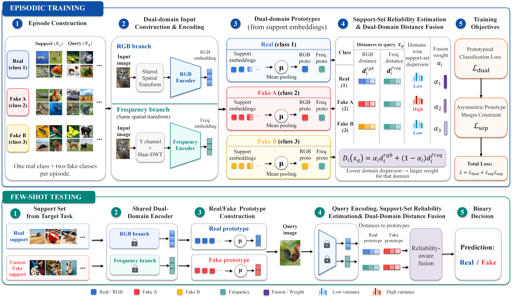

# DDFSD: Dual-Domain Prototypical Learning for Few-Shot AI-Generated Image Detection

<p align="center">
  <a href="https://github.com/xuejianhuang/DDFSD/stargazers"></a>
  
  = 2.3.0">
  <a href="./LICENSE"></a>
</p>

This repository provides the released DDFSD code, experiment wrappers, and pretrained artifacts. Given a small collection of labeled real and synthetic examples for a generator excluded from training, the evaluation program assembles a task-specific detector and applies it to the remaining images.

<p align="center">
  
</p>
<p align="center"><em>Fig. 1. Training and few-shot testing workflow implemented in this repository.</em></p>

---

## Implementation at a Glance

Every sample is converted into two spatially aligned tensors before feature extraction:

- an RGB view for image-level visual content;
- a frequency view formed from the signed `LH`, `HL`, and `HH` Haar-DWT bands of the luminance channel.

The main pipeline follows the module naming used in the project:

| Module | Repository behavior |
| --- | --- |
| **Dual-domain input construction** | Applies a shared spatial transform, then derives the RGB tensor and the luminance-wavelet tensor. |
| **Dual-domain encoding** | Uses independent RGB and frequency backbones with projection heads. |
| **Dual-domain prototypes** | Computes one support centroid per class and per encoder branch. |
| **Support-set reliability estimation** | Computes each branch's average squared deviation around its class centroid. |
| **Dual-domain distance fusion** | Converts the support statistics into class-dependent mixing weights for query-to-prototype distances. |
| **Few-shot testing** | Initializes the real/fake decision rule from support examples; target-task execution uses forward passes only. |

The episode sampler selects three source labels at a time: `real` and two generator IDs. Optimization combines query classification with a pairwise prototype penalty whose real--fake and fake--fake margins are configured separately.

---

## Quick Start

### 1. Clone the repository

```bash
git clone https://github.com/xuejianhuang/DDFSD.git
cd DDFSD
```

### 2. Create an environment

```bash
python -m venv .venv
```

Activate it on Linux or macOS:

```bash
source .venv/bin/activate
```

Activate it in Windows PowerShell:

```powershell
.venv\Scripts\activate
```

Install the dependencies:

```bash
python -m pip install --upgrade pip
pip install -r requirements.txt
```

A CUDA-enabled PyTorch build should be installed separately when the default package does not match the local CUDA runtime.

### 3. Prepare GenImage

Set `DATA_ROOT` to the directory that directly contains the seven project-level categories:

```text
GenImage/
|-- real/
|   |-- train/
|   `-- val/
|-- ADM/
|   |-- train/
|   `-- val/
|-- BigGAN/
|   |-- train/
|   `-- val/
|-- glide/
|   |-- train/
|   `-- val/
|-- Midjourney/
|   |-- train/
|   `-- val/
|-- SD/
|   |-- train/
|   `-- val/
`-- VQDM/
    |-- train/
    `-- val/
```

The dataset can be obtained from the [GenImage project page](https://genimage-dataset.github.io/). Dataset files are not distributed with this repository.

> **Data-layout note:** `SD` denotes the merged Stable Diffusion category used by this codebase. An end-to-end conversion script from the original GenImage release to the layout above is not currently included.

### 4. Train one held-out-generator task

```bash
DATA_ROOT=/path/to/GenImage \
EXCLUDE_CLASS=ADM \
bash scripts/train_main.sh
```

Valid values of `EXCLUDE_CLASS` are `ADM`, `BigGAN`, `glide`, `Midjourney`, `SD`, and `VQDM`.

### 5. Evaluate the trained task

```bash
DATA_ROOT=/path/to/GenImage \
EXCLUDE_CLASS=ADM \
bash scripts/eval_main.sh
```

The default evaluation preset loads the step-15,000 checkpoint, performs 10-shot testing with seeds `42, 101, 102, 103, 104`, uses all remaining validation images as queries, and reports ACC, AP, and AUC.

### 6. Run the complete six-task protocol

```bash
MODE=all \
DATA_ROOT=/path/to/GenImage \
bash scripts/run_main_experiment.sh
```

Available modes are:

- `MODE=train`: train all six tasks;
- `MODE=eval`: evaluate existing runs;
- `MODE=all`: train first and evaluate afterward.

The task order is `ADM`, `BigGAN`, `glide`, `Midjourney`, `SD`, and `VQDM`. Execution stops when a task returns an error.

---

## Pretrained Checkpoints

Pretrained models are available from [Baidu Netdisk](https://pan.baidu.com/s/1YmL59_hJIIguExwbGzEbQA?pwd=vuuy).

After extraction, the package should have the following form:

```text
DDFSD_pretrained/
|-- exclude_ADM/
|   |-- ddfsd_step[15000].pth
|   `-- freq_stats.pt
|-- exclude_BigGAN/
|   |-- ddfsd_step[15000].pth
|   `-- freq_stats.pt
|-- exclude_glide/
|   |-- ddfsd_step[15000].pth
|   `-- freq_stats.pt
|-- exclude_Midjourney/
|   |-- ddfsd_step[15000].pth
|   `-- freq_stats.pt
|-- exclude_SD/
|   |-- ddfsd_step[15000].pth
|   `-- freq_stats.pt
|-- exclude_VQDM/
|   |-- ddfsd_step[15000].pth
|   `-- freq_stats.pt
|-- MANIFEST.csv
|-- SHA256SUMS.txt
`-- README.txt
```

A checkpoint and its `freq_stats.pt` file form a task-specific pair. Both files must come from the same `exclude_<CLASS>` directory. Mixing artifacts from different held-out-generator tasks changes the frequency normalization and produces an invalid evaluation setup.

The package also provides:

- `MANIFEST.csv` for artifact metadata;
- `SHA256SUMS.txt` for integrity verification;
- `README.txt` for checkpoint-specific usage notes.

### Evaluate a downloaded checkpoint

```bash
DATA_ROOT=/path/to/GenImage \
EXCLUDE_CLASS=ADM \
CKPT_PATH='/path/to/DDFSD_pretrained/exclude_ADM/ddfsd_step[15000].pth' \
FREQ_STATS_PATH='/path/to/DDFSD_pretrained/exclude_ADM/freq_stats.pt' \
OUTPUT_DIR='/path/to/results/exclude_ADM' \
bash scripts/eval_main.sh
```

Keep the checkpoint path quoted because its filename contains square brackets. Custom run layouts can also be specified through `RUN_ROOT`, `RUN_DIR`, `CKPT_PATH`, `FREQ_STATS_PATH`, and `OUTPUT_DIR`.

---

## Reproducibility Notes

Frequency normalization is task-dependent. During training, the code estimates the frequency-domain mean and standard deviation using the training split of `real` and the five non-excluded fake classes, then stores the result in `freq_stats.pt`.

For formal evaluation:

1. load the statistics saved by the matching training task;
2. do not estimate new statistics from validation or test images;
3. keep the held-out generator consistent across `EXCLUDE_CLASS`, the checkpoint, and `freq_stats.pt`;
4. use the dual-branch adaptive-fusion setting for the main protocol.

The training wrapper uses a single process through `torchrun --nproc_per_node 1`. Bash is required for the supplied shell scripts.

---

## Main Experiment Preset

| Item | Setting |
| --- | --- |
| Dataset | GenImage |
| Evaluation design | Six held-out-generator tasks |
| Training length | 15,000 steps |
| Batch size | 16 |
| Training episode | 3-way: one real class and two fake classes |
| Samples per episodic class | 5 support and 5 query images |
| RGB encoder | ResNet-50 |
| Frequency encoder | ResNet-18 |
| Embedding size | 512 |
| Frequency representation | Signed Haar-DWT `LH`, `HL`, and `HH` bands from the Y channel |
| Optimizer schedule | StepLR, step size 5,000, gamma 0.5 |
| Backbone learning rate | `3e-5` |
| Projection-head learning rate | `1e-4` for both domains |
| Margin parameters | `m_rf=1.2`, `m_ff=0.6`, `lambda_ff=0.5` |
| Separation-loss weight | `lambda_sep=0.03` after linear warmup from steps 2,500 to 7,500 |
| Branch sampling | Dual/RGB-only/frequency-only = `0.90 / 0.05 / 0.05` |
| Formal test preset | Step 15,000; 10-shot; 5 seeds; full validation query set |
| Reported metrics | ACC, AP, and AUC |

These values describe the released execution preset rather than a summary of experimental results.

---

## Output Files

The default scripts write task outputs outside the repository:

```text
<run_root>/
`-- main_full_steps15000/
    `-- exclude_<class>/
        |-- ckpt/
        |   `-- ddfsd_step[15000].pth
        |-- tb/
        |-- logs/
        |   |-- train_driver.log
        |   |-- eval_driver.log
        |   `-- <timestamp>_log.txt
        |-- train.log
        |-- freq_stats.pt
        `-- formal_eval_step15000/
            |-- ddfsd_eval_per_seed.csv
            |-- ddfsd_eval_summary.csv
            |-- formal_val_invalid_images.csv
            |-- config.json
            |-- logs/
            |   `-- <timestamp>_log.txt
            `-- eval.log
```

Key evaluation artifacts are:

| File | Content |
| --- | --- |
| `ddfsd_eval_per_seed.csv` | Metrics for each evaluation seed |
| `ddfsd_eval_summary.csv` | Mean and standard deviation across seeds |
| `formal_val_invalid_images.csv` | Validation-image audit results |
| `config.json` | Resolved paths and protocol settings |
| `eval.log` | Console output from formal evaluation |

TensorBoard events are stored in the task-level `tb/` directory:

```bash
tensorboard --logdir /path/to/run_root/main_full_steps15000 --host 0.0.0.0 --port 6006
```

---

## Repository Layout

```text
DDFSD/
|-- datasets/
|   `-- ddfsd_datasets.py          # GenImage parsing, transforms, and iterators
|-- figs/
|   `-- ddfsd_framework.png        # Framework illustration
|-- model/
|   |-- ddfsd.py                   # Encoders and projection heads
|   `-- ddfsd_losses.py            # Prototype, fusion, and margin losses
|-- scripts/
|   |-- train_main.sh              # Train one held-out-generator task
|   |-- eval_main.sh               # Evaluate one task
|   `-- run_main_experiment.sh     # Execute all six tasks
|-- tests/
|   `-- test_ddfsd_core.py         # Core implementation tests
|-- util/                          # Sampling, frequency, logging, and evaluation utilities
|-- train_ddfsd.py                 # Python training entry point
|-- test_ddfsd.py                  # Python evaluation entry point
|-- requirements.txt
|-- LICENSE
`-- README.md
```

---

## Reference Implementations Used for Comparison

The experimental study includes the following external detectors. Their source code and licenses are maintained by the respective authors.

| Category | Methods |
| --- | --- |
| Spatial-domain detection | [CNNSpot](https://github.com/PeterWang512/CNNDetection), [NPR](https://github.com/chuangchuangtan/NPR-DeepfakeDetection) |
| Frequency-domain detection | [FreqNet](https://github.com/chuangchuangtan/FreqNet-DeepfakeDetection) |
| Spatial-frequency or foundation-model-based detection | [FatFormer](https://github.com/Michel-liu/FatFormer), [UnivFD](https://github.com/WisconsinAIVision/UniversalFakeDetect), [VIB-Net](https://github.com/oceanzhf/VIBAIGCDetect) |
| Few-shot detection | [FSD](https://github.com/teheperinko541/Few-Shot-AIGI-Detector), [LIDA](https://github.com/hongsong-wang/LIDA) |

These external repositories are not bundled with DDFSD.

---

## Environment Summary

| Component | Requirement |
| --- | --- |
| Python | 3.10 |
| PyTorch | `torch>=2.3.0` |
| Hardware | CUDA-capable GPU with a compatible PyTorch build |
| Execution mode | Single GPU |

Core Python packages include:

```text
torch>=2.3.0
torchvision
timm
numpy
Pillow
scikit-learn
tensorboard
```

---

## Acknowledgements

We thank the authors of **FSD: Few-Shot Learner Generalizes Across AI-Generated Image Detection** for releasing their implementation, which served as an important code reference for this project.
